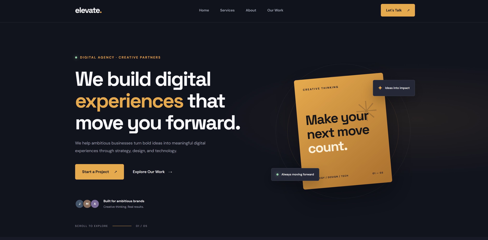

# Elevate Agency Express



A modern digital agency landing page built with **HTML, CSS, JavaScript, Node.js, Express, and PostgreSQL**. The project demonstrates a simple full-stack architecture with a responsive frontend, an Express backend, and a PostgreSQL database for storing contact form submissions.

## Overview

Elevate Agency is a digital agency landing page designed to present services, showcase the agency, and allow potential clients to get in touch through a contact form.

The contact form sends data asynchronously to the Express backend using the Fetch API. Express processes the submission and stores the message in PostgreSQL.

## Features

- Responsive digital agency landing page
- Modern frontend built with HTML and CSS
- Interactive functionality using vanilla JavaScript
- Node.js and Express backend
- Contact form submission using the Fetch API
- PostgreSQL database integration
- Contact messages stored in PostgreSQL
- Docker-based PostgreSQL setup
- Environment variable configuration with dotenv
- Database queries using parameterized SQL

## Technologies Used

| Technology | Purpose |
|---|---|
| HTML5 | Website structure |
| CSS3 | Styling and responsive layout |
| JavaScript | Frontend interactions and Fetch API |
| Node.js | JavaScript runtime |
| Express.js | Backend server and API routes |
| PostgreSQL 18 | Relational database |
| Docker | PostgreSQL container |
| pg | PostgreSQL client for Node.js |
| dotenv | Environment variable management |
| Nodemon | Development server auto-restart |

## Project Structure

```text
elevate-agency-express/
│
├── public/
│   ├── index.html
│   ├── style.css
│   └── script.js
│
├── src/
│   └── config/
│       └── database.js
│
├── screenshots/
│   ├── banner.png
│   └── full-page.png
│
├── .env
├── .env.example
├── .gitignore
├── docker-compose.yml
├── init.sql
├── package.json
├── package-lock.json
└── server.js
```

*The structure above represents the main project files. Adjust it if your actual folders or filenames differ.*

## Getting Started

### Prerequisites

Make sure you have the following installed:

- [Node.js](https://nodejs.org/)
- [npm](https://www.npmjs.com/)
- [Docker Desktop](https://www.docker.com/products/docker-desktop/)

### 1. Clone the Repository

```bash
git clone YOUR_REPOSITORY_URL
```

Navigate into the project directory:

```bash
cd elevate-agency-express
```

### 2. Install Dependencies

```bash
npm install
```

### 3. Configure Environment Variables

Create a `.env` file in the project root:

```env
DB_HOST=localhost
DB_PORT=5432
DB_NAME=elevate_agency
DB_USER=elevate_user
DB_PASSWORD=your_database_password
```

Replace the password with the one configured in your Docker Compose file.

### 4. Start PostgreSQL with Docker

Start the database container:

```bash
docker compose up -d
```

Check the container status:

```bash
docker ps
```

### 5. Initialize the Database

The `init.sql` file contains the SQL commands required to create the contact messages table and its index.

For an already initialized database, execute the SQL file manually:

```bash
docker exec -i elevate-agency-db psql -U elevate_user -d elevate_agency < init.sql
```

### 6. Start the Development Server

```bash
npm run dev
```

Open the website:

```text
http://localhost:3000
```

## Contact Form Workflow

The contact form follows this process:

1. A visitor enters their name, email, subject, and message.
2. Frontend JavaScript captures the form submission.
3. The Fetch API sends the information to the Express `/contact` endpoint as JSON.
4. Express receives and processes the request.
5. The `pg` package executes a parameterized SQL query.
6. PostgreSQL stores the contact message.
7. Express returns a JSON success or error response.
8. The frontend displays the appropriate feedback without reloading the page.

## Database Structure

The project uses a PostgreSQL table named `contact_messages`.

| Column | Type | Description |
|---|---|---|
| id | SERIAL | Primary key |
| name | VARCHAR(100) | Sender's name |
| email | VARCHAR(255) | Sender's email |
| subject | VARCHAR(150) | Message subject |
| message | TEXT | Contact message |
| created_at | TIMESTAMPTZ | Submission timestamp |

## Useful Database Commands

Connect to PostgreSQL:

```bash
docker exec -it elevate-agency-db psql -U elevate_user -d elevate_agency
```

List tables:

```sql
\dt
```

View the table structure:

```sql
\d contact_messages
```

View submitted messages:

```sql
SELECT * FROM contact_messages ORDER BY created_at DESC;
```

Exit PostgreSQL:

```sql
\q
```

## Screenshots

### Full Page Preview


## Learning Objectives

This project was built to practice and demonstrate:

- Building a backend with Node.js and Express.
- Connecting an Express application to PostgreSQL.
- Managing database connections using `pg` and connection pooling.
- Configuring environment variables with dotenv.
- Running PostgreSQL through Docker Compose.
- Handling asynchronous frontend requests with the Fetch API.
- Processing JSON data in Express.
- Saving form submissions using parameterized SQL queries.

## Future Improvements

- Add server-side form validation.
- Add rate limiting and spam protection.
- Build an admin dashboard to manage contact messages.
- Add email notifications for new submissions.
- Improve accessibility and performance.


